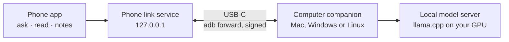

# OPOS GPU Link

**Put your phone to good use: private AI, right in your pocket.**

Small models run on your phone; bigger ones run on your own computer's GPU over a USB-C cable. No cloud.

Ask a question on your Android phone and read both answers side by side. Pull the cable and the GPU answer pauses. Plug it back in and it picks up where it left off.

## Quick start

1. **adb.** Install Google's [Android SDK Platform-Tools](https://developer.android.com/tools/releases/platform-tools) for `adb`.
2. **Computer.** Download the app for your Mac, Windows PC or Linux machine from [Releases](../../releases) and check it against `SHA256SUMS`. The first time, run it with `--prefetch` to download a model that fits your GPU. After that, run it plainly: it finds your GPU, uses the model on disk and starts a local model server. To run from source instead, see [`companion/SETUP.md`](companion/SETUP.md).
3. **Phone.** Turn on USB debugging, plug in the cable, accept the computer's prompt, and install the APK from [Releases](../../releases).
4. **Pair.** Compare the six-digit code on both screens and tap **Allow** on the phone. The button names your computer, for example **Allow this MacBook** on a MacBook. Later plugs reuse that pairing.
5. **Ask.**

Build the app yourself with `android/scripts/build-debug-apk.sh`.

## What's here

| | |
| --- | --- |
| `android/` | The phone app |
| `phone-service/` | The phone side of the link: pairing, signed requests, pause and resume |
| `companion/` | The computer companion (Mac, Windows, Linux) and its tests |

## Models in the demo

The Dec 10 2026 demo runs three NVIDIA models as local GGUF files, plus two comparison baselines. Sizes and recorded SHA-256 values were computed with `shasum -a 256` from files on the demo MacBook on 27 Nov 2026 (America/Los_Angeles).

| Where | Model | File | Size | SHA-256 | License |
| --- | --- | --- | --- | --- | --- |
| MacBook (Metal) | [NVIDIA Nemotron 3.5 Bolt E4B 4GB, Q4_K_M](https://huggingface.co/nvidia/NVIDIA-Nemotron-3.5-Bolt-E4B-4GB) | `Nemotron-3.5-Bolt-E4B-Q4_K_M.gguf` | 6.18 GB (6,180,446,208 bytes) | `c8af2b8aea10a690a1d9491db744a9446660173cb38fc489612b556615a69612` | OpenMDW-1.1 |
| Phone, lead | [NVIDIA AceInstruct 1.5B, Q4_K_M](https://huggingface.co/bartowski/nvidia_AceInstruct-1.5B-GGUF) (community quant) | `nvidia_AceInstruct-1.5B-Q4_K_M.gguf` | 1.12 GB (1,117,318,944 bytes) | `103b7fa617d2b3c2d6e168a878b9b5e3710d19d178bf4b890acf0fac2abafadb` | CC-BY-NC-4.0 |
| Phone, second | [NVIDIA Nemotron Mini 4B Instruct, Q4_K_M](https://huggingface.co/bartowski/Nemotron-Mini-4B-Instruct-GGUF) (community quant) | `Nemotron-Mini-4B-Instruct-Q4_K_M.gguf` | 2.70 GB (2,697,387,072 bytes) | `2bf02846dbd45e9580b9338b90505fb54e00d185713d4b7f06699e2d5d298e48` | NVIDIA Open Model License |
| Phone, comparison only | [LFM2 1.2B (Liquid AI)](https://huggingface.co/LiquidAI/LFM2-1.2B-GGUF) | `LFM2-1.2B-Q4_K_M.gguf` | 0.73 GB (730,893,248 bytes) | `55175400e3f509a9616227afeffd58d87e80b9f628a5d3d54ada884d85221fed` | [LFM Open License v1.0](https://huggingface.co/LiquidAI/LFM2-1.2B-GGUF/blob/main/LICENSE) |
| MacBook, comparison only | [Gemma 4 26B (Google)](https://huggingface.co/google/gemma-4-26B-A4B-it-qat-q4_0-gguf) | `gemma-4-26B_q4_0-it.gguf` | 14.44 GB (14,439,363,584 bytes) | Not recorded | Apache-2.0 |

LFM2 is shown as "LFM2 1.2B (baseline)"; Gemma is a measured baseline and rollback. Gemma's SHA-256 was not recorded while LM Studio was serving it.

Nemotron 3.5 Bolt E4B is post-trained by NVIDIA from Google's Gemma 4 E4B, so Gemma's terms also apply. On a MacBook, Bolt runs on Apple's GPU through Metal, not on an NVIDIA GPU. Any other local GGUF works too; the companion picks one that fits your GPU.

## Supported platforms

| | |
| --- | --- |
| Phone | Android 10+ (tested on a Galaxy Z Flip6, inner and cover screens) |
| macOS | Apple silicon (Metal), Intel with a Vulkan GPU |
| Windows | x86_64, NVIDIA (CUDA) or AMD/Intel (Vulkan) |
| Linux | x86_64, NVIDIA (CUDA) or Vulkan |

## Private

Private: runs on your phone and your own computer, no cloud.

- The computer companion downloads nothing by default. It uses models already on disk; fetching one is opt-in (`--prefetch`).
- The phone app talks only to its own loopback service. The computer is reached only through the USB forward.
- Every request is signed with a key set up when you pair.

## Status

Early demo build.

- The APK is a debug build signed with a throwaway key. It is not on Google Play.
- The phone side runs on its own with `phone-service/run_link.py`, including the `/api/ai` endpoint the app reads. The phone lane needs a local OpenAI-compatible server on the phone, such as `llama-server`; without one, questions go to the computer.
- The macOS apps are ad-hoc signed, not notarized, so macOS asks before the first run.
- USB is the only link today. Wireless isn't built yet.

OPOS GPU Link is part of the early Old Phone OS project, coming soon.

## License

Apache-2.0. See [LICENSE](LICENSE), [NOTICE](NOTICE) and [THIRD_PARTY.md](THIRD_PARTY.md). To report a vulnerability, see [SECURITY.md](SECURITY.md). To open an issue or a pull request, see [CONTRIBUTING.md](CONTRIBUTING.md).
